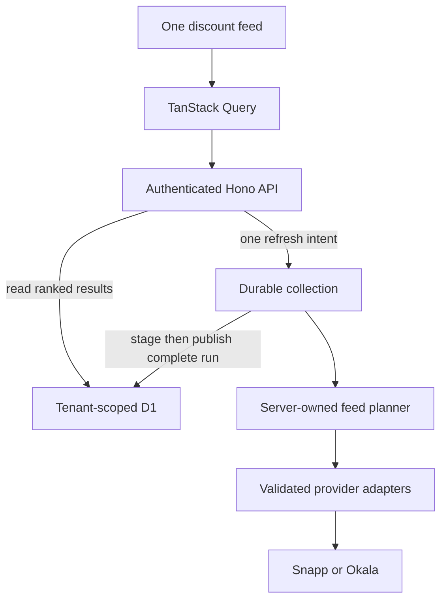

# Better Buy: automatically surfaced discounts and simple store comparison

Status: ticket-ready specification with explicit research gates. Revised 10 October 2026 after the product-direction review. This document is the input for Matt Pocock’s `/to-tickets`; it does not publish issues or authorize a production deployment.

## Problem Statement

The shopper’s problem is the work of finding worthwhile discounts across scattered Snapp feeds and stores. Requiring them to choose a category, campaign, and store before seeing results repeats that work. Better Buy should do the discovery and aggregation itself, then present useful offers in a simple Persian RTL feed.

The current backend collects Market Party but misses other candidate discount feeds. The current grouping also splits one product when stores charge different prices. Broader collection must preserve stock evidence, benefit conditions, price units and honest coverage; a small set of observed offers cannot be mistaken for Snapp’s whole catalog.

## Solution

After a shopper sets a delivery location, show the latest available discount results immediately. One refresh action finds offers using a server-owned collection policy. The backend discovers campaigns, chooses validated feeds within its budget, collects stock-backed offers, deduplicates them and ranks the results. The shopper sees products and prices, with an expandable store comparison.

There is no Explore destination, category tree, campaign picker, store-first browsing flow, or user-selected collection scope in this release. Categories and campaigns are backend tools for improving discovery and coverage. Their names can be retained as provenance, but they are not decisions the shopper must make.

One product row shows the best observed applicable item offer, coherent original/final prices, discount percentage and store name. Search is optional after results appear. A small settings menu can expose threshold and the existing retailer choice; neither is required to begin. History remains secondary. Preserve previous successful results while collection runs or fails.

### Product priorities

| Priority | Outcome                                                           | Release condition                                                          |
| -------- | ----------------------------------------------------------------- | -------------------------------------------------------------------------- |
| P0       | Existing results remain trustworthy and recoverable               | Threshold, scope, error and read-model fixes pass                          |
| P1       | One calm automatic discount feed with store comparison            | No category/campaign/store setup required; correct money and identity      |
| P2       | Automatic collection from additional validated Snapp feeds        | Server-owned planner, durable collection and pagination/runtime gates pass |
| P3       | Improve default coverage and ranking based on measured usefulness | Net-new eligible offers, freshness, latency and cost justify expansion     |

The default never means an all-category × all-store crawl. A useful first release uses the existing feed through the simplified experience; further feed adapters enrich that same experience without introducing new navigation.

## User Stories

1. As a shopper, I want to set my delivery location and see worthwhile discounts, so I do not need to browse categories or campaigns.
2. As a first-time shopper, I want manual location entry, so declining geolocation does not block me.
3. As a returning shopper, I want the latest successful results immediately, so a new collection does not empty the page.
4. As a shopper, I want Better Buy to find additional discount sources automatically, so I do not need to understand Snapp’s promotional structure.
5. As a shopper, I want a useful default threshold, so I can start without configuration.
6. As a shopper, I want optional threshold/retailer settings, so I can adjust the feed when I choose.
7. As a shopper, I want discounts ranked by an understandable rule, so the first results are easy to evaluate.
8. As a shopper, I want different store offers for the same verified product in one row, so comparison takes fewer steps.
9. As a shopper, I want headline price and savings from the same offer, so displayed savings are coherent.
10. As a shopper, I want one store comparison disclosure, so the main feed stays uncluttered.
11. As a shopper, I want stock-backed offers only, so indicative product prices do not look purchasable.
12. As a shopper, I want ordinary and conditional discounts distinguished, so an inapplicable promotion cannot appear cheapest.
13. As a shopper, I want all displayed prices labeled in toman, so provider units do not mislead me.
14. As a shopper, I want delivery facts when actually known, so the item price is not presented as a basket total.
15. As a shopper, I want optional search within already-found results, so I can find a product without configuring collection.
16. As a shopper, I want to load more saved results, so viewing another page does not start another upstream crawl.
17. As a shopper, I want a simple refresh action, so I can update the feed without selecting internal sources.
18. As a shopper, I want honest progress, so I know collection is working without fabricated percentages.
19. As a shopper, I want durable collection to continue after I leave, so I can return to completed results.
20. As a shopper, I want to cancel a long update, so it stops additional collection work.
21. As a shopper, I want failures and incomplete runs to preserve previous results, so a broader update cannot erase useful offers.
22. As a shopper, I want failed result reads to retry the same saved result, so I do not start another collection unnecessarily.
23. As a shopper, I want an uncertain start checked safely, so I cannot accidentally create duplicate jobs.
24. As a shopper, I want a location change to discard old responses, so old offers cannot appear under a new location.
25. As a shopper, I want history to preserve its original context, so edits do not rewrite past results.
26. As a shopper, I want absence described accurately, so a feed omission does not look like confirmed out-of-stock status.
27. As a shopper, I want private caches cleared on session changes, so another account cannot see my data.
28. As a keyboard/screen-reader user, I want accessible controls and comparisons, so I can complete the same tasks.
29. As a mobile shopper, I want readable prices and easy controls at 360px, so the feed works comfortably on my phone.
30. As a returning user, I want historical Jet and legacy data readable, so the redesign preserves my history.
31. As a maintainer, I want endpoint changes to fail safely, so malformed data does not look like an empty market.
32. As a maintainer, I want coverage, overlap and cost evidence, so automatic discovery improves the product without requiring more user choices.

## Implementation Decisions

### D01. Preserve the existing stack and user constraints

Keep the static Next.js/React frontend, TanStack Query v5, Hono HTTP layer, Better Auth, D1, Zod and Effect 4. Keep local Persian fonts and the existing component foundations. Do not upgrade frameworks as part of this feature. Use the project’s declared pnpm version for implementation and CI.

Effect owns provider work, interruption, typed failure and scoped resources. TanStack Query owns frontend server state, cancellation, retries, invalidation and polling. Local state owns view selection and controls. Do not add direct application `useEffect`/`useLayoutEffect` orchestration, custom polling timers, or side effects during rendering. Library internals are not a reason to recreate effects in application code.

Use a narrow page-collection seam and the existing application/store seams. Do not build a generalized crawler framework, generic plugin system, Redux layer, or cross-provider product matcher.

### D02. Separate backend discovery from the shopper’s feed

The backend distinguishes product-only discoveries, concrete stock-backed observations, and completed feed snapshots. Discovery rows are internal candidates; they never appear as eligible offers without concrete verification. Only completed snapshots drive temporal absence comparison.

The frontend consumes one saved product feed. Its pagination reads collected results; it does not ask Snapp for a new category or campaign page. Changing a presentation filter cannot change the collection manifest or start a job. No public category/campaign browsing API is needed for this release.

First location confirmation is an explicit user intent and can start the first default collection in that event handler, after the location save succeeds. Revisiting a page reads cached/persisted results; it never starts a POST from a GET, render, or effect. With a saved location but no snapshot, show one “پیدا کردن تخفیف‌ها” action. Returning users see saved results and “به‌روزرسانی تخفیف‌ها”.

### D02a. Server-owned automatic discovery policy

The server chooses the feed manifest for a location and retailer. Start with the existing Market Party adapter. Behind gates, discover live home collections and add validated concrete-offer adapters that have demonstrated net-new eligible coverage. Choose sources using a versioned deployment policy, not a shopper’s category selections. Dynamic IDs are resolved each run rather than hardcoded.

Initial expansion is at most two supplementary collections per run. Only admit collections whose verified pagination/count semantics and expected work fit the remaining budget. Unknown/unbounded feeds stay out of the planned manifest. Stable selection uses validated collection metadata and deterministic ordering; a promotional title alone does not establish applicability or completeness. Record omitted candidates and reasons operationally. This count cap is a proposed starting policy, subject to G06 measurements.

Store-category APIs are a later backend enrichment option only when the coverage experiment demonstrates a useful bounded store/category cohort. The server chooses that cohort; the shopper is never sent into a category tree. Product-only category search is an internal candidate-discovery tool, not the default customer feed.

Freeze the admitted manifest before collection. Once a feed is admitted, failure cannot silently remove it from the manifest and turn an incomplete run into a complete one. Preserve previous successful results. Releasing additional adapters and selecting them automatically are one product capability; shipping customer browsing is not a fallback for a blocked collection gate.

### D02b. Simple deterministic ranking

Default ordering is greatest applicable discount percentage, then greatest absolute discount amount, then lower final item price, then stable group key. Calculate ranking from the same best-current-offer tuple shown in the product row. Offer-level stock/condition validation precedes ranking. The percentage and item price are visible, so the ordering is explainable.

This is discount ranking, not personalized relevance or a claim of lowest delivery-inclusive basket price. Preserve different product variants. Do not add AI recommendations, behavioral profiling or a weighted black-box score. Users can optionally choose lower-price ordering from a small control after results exist; category selection is never required.

### D03. Keep provider shapes independent

Create separate validated adapters for categories, stores, home collections, product discovery, concrete campaign offers, store-category offers and Market Party. Their outputs map to shared domain types after validation. Similar upstream names do not make the schemas interchangeable.

Use an allowlisted production origin and adapter-built paths. Never follow upstream category URLs pointing at a development hostname. Never accept a client-provided upstream URL. Validate numeric IDs and vendor codes independently of URL construction.

Treat 204 as an endpoint-specific empty response only after the request contract is known. A malformed body, false success envelope, unexplained empty payload, or wrong filter encoding is not an empty successful catalog.

### D04. Discount and stock normalization

Each concrete offer contains stable provider, vendor and product identity; original amount; discount amount; final amount; percentage when available; currency unit; stock evidence; benefit information; observation time; and provenance.

`discount` in the observed Snapp feeds is an amount. Compute final price once as original minus discount amount, using validated finite nonnegative values. Never apply the percentage a second time. A missing percentage may be derived from an original amount greater than zero, with `ratioEvidence: derived`; preserve the unrounded value for eligibility and round only the displayed percentage. A supplied percentage inconsistent with amount-derived savings beyond a documented rounding tolerance is a quarantined schema/price anomaly, not a silently corrected bargain.

Use integer source money where the feed supports it. Reject negative discount, discount greater than original, nonfinite values, and a fabricated zero final price produced by clamping invalid data. Free products with valid zero-price semantics require an explicit provider case rather than dividing by zero.

An ordinary eligible offer requires positive stock, no out-of-stock flag, an applicable benefit, and a discount at or above the effective threshold. Missing stock is `unknown`, not zero and not in stock. Product discovery never satisfies this test. A store’s `isOpen` is not a promise that it delivers to the saved location; retain `doesDeliver` only when returned and distinguish `unknown`.

Snapp’s observed money is already toman. Okala money is rial and converts to toman for display. New contracts use explicit `sourceMoneyUnit` plus a display amount. Existing misleading `*Rials` fields remain readable during expansion; do not divide old Snapp amounts by ten or destructively rename the entire database in one ticket.

### D05. Retain offer conditions and provenance

Use benefit kinds `standard_discount`, `market_party`, and `conditional` with explicit unknown terms where necessary. Preserve campaign identity, validity times, quantity caps and eligibility text when the adapter actually receives them. Do not infer Pro, coupon, or subsidy eligibility from a title.

Ordinary offer identity is provider + vendor ID + product ID + benefit identity. Keep conditional and standard offers distinct even when product/store IDs match. Multiple ordinary feeds can point at the same offer; attach multiple provenance records without multiplying the store count or stock quantity.

For overlapping ordinary observations with different prices, keep a deterministic observation policy: latest successfully observed complete price tuple wins; equal-time ties use stable adapter priority and feed identity. Retain a conflict diagnostic. Do not assemble the minimum final price from one observation with the original price or discount from another. Replayed pages retain their original stored observation tuple.

A broad recommendation compares applicable ordinary offers first. Conditional offers appear in a separate disclosure with their terms. Unknown restrictions are labeled; they are not automatically crowned the cheapest universally available option.

### D06. Product grouping v2 enables real store comparison

Keep raw offers as truth. A new read projection groups by provider + provider product/variation ID + safely normalized variant title. Price is excluded from product identity. Category and image are presentation metadata, not identity when verified IDs and variant signatures agree.

Normalize only Unicode NFKC, Persian/Arabic ی and ک variants, ZWNJ/whitespace presentation differences. Do not remove weights, sizes, multipack counts or flavors. Do not fuzzy-match titles. If the same ID has conflicting variant signatures, split groups and emit a diagnostic. Snapp and Okala never share a product group.

Return `groupKeyVersion: 2`. Keep v1 reads compatible for legacy clients/history during migration. A stable v2 key is a versioned digest of the canonical identity, independent of current price and vendor count; do not put a whole serialized product tuple into a path segment. The preferred current offer is the lowest final item price among comparable applicable offers, with deterministic ties by vendor ID and offer key. All headline money and discount facts are copied from that offer. A historical-only group has no current best price.

Do not sum stock across duplicated feed observations. Per-store stock is evidence from the selected observation; a combined stock number, if retained at all, is a deduplicated observed total with clear meaning rather than a promise of obtainable inventory.

### D07. Freeze location and scan scope

Add a location coordinate revision that changes when coordinates change. Name-only edits do not change geographic comparability. Save location name, exact coordinates and revision on each new scan. Old scans without those facts are `legacy_unverified` for cross-scan comparison; preserve their original data without inventing historical coordinates from today’s location.

A scan’s canonical scope includes provider, adapter contract version, server-selected feed kinds, sorted collection/store/category IDs, explicit store cohort where applicable, effective threshold, eligibility version and offer-key version. Sort/deduplicate the set before hashing. Store the actual manifest as well as its hash. Titles and display order do not change identity; collection membership does.

The server-selected manifest is frozen before offer collection. A newly discovered collection is not appended mid-scan. Dynamic homepage discovery creates the manifest; if its membership differs from the preceding run, that run has a different scope. Show “coverage changed” and skip temporal absence rather than comparing incomparable feed sets.

Canonical scan scope excludes presentation filters and grouping version. Product grouping is a read projection; changing it does not rewrite raw observations. Effective threshold and eligibility version do affect the set being observed and therefore comparison.

### D08. Conservative history semantics

Compare only successful, complete scans belonging to the same account, provider, location revision, scope hash, effective threshold, eligibility version and offer identity version. Use a deterministic predecessor order, including a scan ID tie-break if timestamps are equal.

The first compatible snapshot has no baseline: show ordinary current results rather than calling every item “new.” Exact current offer keys present in a compatible predecessor are still present. Missing keys are “not found in this scan,” not “out of stock.” Price changes retain offer continuity and can be shown only when both tuples are comparable.

Failed, cancelled, budget-limited, schema-invalid and browse-page results cannot be predecessors. Upstream count drift or pagination anomalies suppress absence comparison even if the user can inspect diagnostic partial observations. A user can view prior successful results while a broader scan fails.

### D09. Honest pagination and completion

Each adapter owns its pagination contract. Store unit/page checkpoints with cursor/page, request parameters, actual returned row count, identity fingerprint, reported totals and terminal evidence. Fingerprints use stable offer or discovery identities, not prices alone.

Stop on a verified explicit `hasNext=false`, verified total/page boundary, or verified terminal empty page according to that adapter’s release evidence. Do not infer exhaustion because a server returned fewer rows than a requested size it ignored. Repeated nonempty identity pages are a pagination anomaly; fail with `INCOMPLETE_PAGINATION` rather than declaring completion.

Count drift is normal in a changing marketplace, but it means a scan is an observation window rather than an atomic catalog snapshot. Record first/last counts and observed duplicates. If the chosen adapter’s completion rule depends on a total that changed incompatibly, mark the run incomplete. Do not certify mutable offset paging as a globally exact stock snapshot.

Hard caps are failure guards, not terminal conditions. Reaching a request/page/time/offer cap produces an incomplete failed scan and preserves the last successful shelf. Progress may show observed rows; it must not expose staged rows as a completed snapshot.

### D10. Durable scans use Cloudflare Workflows after a capability gate

Use a Workflow binding in the existing Worker. Do not use a longer `waitUntil` promise or a single Queue consumer to disguise a whole-catalog scan. Existing bounded execution may remain temporarily for legacy scans while the durable slice is introduced behind a flag.

The HTTP scan start authenticates, validates the tenant-owned location and optional settings, computes the effective threshold once, reserves the scan, and durably records a dispatch intent. The Workflow carries only scan ID and contract version; it reloads tenant and manifest from D1. Revalidate that payload at runtime. Do not carry arbitrary coordinates or credentials from the browser into a background job.

Use a deterministic Workflow instance ID derived from the reserved scan ID. Dispatch occurs outside the D1 transaction, so it can be ambiguous. Persist `dispatch_pending`; try `create`, and on uncertain/duplicate outcome query that same instance ID. A scheduled bounded reconciler retries pending dispatch for the same ID and reconciles terminal engine errors. Authenticated scan reads may trigger the same bounded reconciliation. A Workflow is never recreated for a D1-terminal scan, including after engine retention expires.

A provider page step acquires scoped provider access, fetches and validates one bounded page, stages offers and the page receipt idempotently, and returns only small checkpoint metadata. Do not return a whole offer page or guest token as persisted step output. Step names derive from stable unit/page identities; never use a new timestamp or random UUID when replaying a step.

Preserve the scan’s device UUID across guest acquisition/replay. Guest tokens are server-only scoped resources, refreshed once on a 401 as the existing adapter does. Reacquire safely after a resume if the ephemeral token is gone. Do not introduce customer token fields or global tenant credential caches.

Start sequentially, with at most two concurrent outbound requests only if a measured fixture/live test justifies it. No large parallel fan-out. Browser disconnection does not affect execution. D1 remains the user-facing source for status and history; engine details are operational metadata.

### D11. Idempotent start and recovery

For new clients, accept an `Idempotency-Key` UUID for `POST /api/scans`. Store it with the tenant and canonical request fingerprint. The same key/request returns the same reserved scan; a different request with that key returns 409. Retain the reservation/key as long as scan history, not merely Workflow retention.

Keep one active scan per account unless a later product requirement changes it. The D1 unique active-scan constraint remains authoritative. Starting from another location while a scan is active returns the active scan summary, and the UI can navigate to it without pretending the account has no active work.

Return the actual normalized scan record, not a client-reconstructed queued record. Okala’s effective threshold is `max(30, requestedThreshold)` consistently in reservation, job, collection, response and comparison. The earlier mismatch must be fixed before expanded coverage.

Mutations do not automatically retry. If the response is lost after reservation, keep the key and reconcile scan history/start intent. An explicit “check scan status” action uses reads. If a deliberate resend is needed after reconciliation, it uses the same key; a new scan requires a new explicit intent. Do not generate a new key on rerender.

### D12. Staging and atomic publication

Write validated observations in bounded chunks, guarded by tenant + scan + active status. Maintain a unique page receipt and a unique offer identity per scan. Page receipts include a content digest. On a replay with the same digest, return its existing checkpoint; an unexplained conflicting digest after commit is an anomaly, not an opportunity to double-count.

A page with multiple chunks uses a chunk ledger or equivalent idempotent chunk keys. Mark the page complete only after all intended chunks exist. Do not store a “complete page” receipt before its offers are durable. A retried staging step first consults committed checkpoints, so it need not refetch a committed mutable page.

Only a guarded final transition publishes. It checks all frozen units are terminal, no cancel flag, no unresolved anomaly, and a coherent materialized product projection is ready. Reads require the scan to be succeeded with published coverage; they cannot leak staged rows from running/failed scans. An incomplete job never advances the latest successful selection.

Do not issue thousands of per-row inserts in one giant D1 batch. Begin with small bounded batches sized against bind/statement limits and measured D1 behavior. Transactions use D1’s binding batch semantics, not unsupported interactive `BEGIN` across network calls. A final status flip is the publication boundary. Test using the actual local D1 binding as well as pure fixtures. Check affected-row counts: a successful SQL execution that updated zero rows is not a successful publication.

Cancellation uses an additive `cancelled` terminal status and a compare-and-set transition. If cancellation commits first, all subsequent page and publication writes are rejected. If publication commits first, cancellation reports the already completed run. Stop additional outbound work cooperatively and terminate the engine best-effort. No fabricated promise that an in-flight upstream request can always be cancelled before it arrives.

### D13. Bounded automatic collection and retry ownership

The existing Effect HTTP helper retries safe GETs. Under a Workflow page step, configure it for one attempt and make the Workflow step the owner of transient retries. Otherwise retries multiply. Allow three total attempts for network errors, timeout, 408, 429 and 5xx; no retries for malformed schemas, invalid selectors, forbidden access or cancellation. Honor valid Retry-After within the job deadline. Count guest refresh/access attempts too. Browser mutations never automatically retry.

Proposed default-run guards: 15-minute elapsed deadline, 250 outbound attempts including access/retries, 100 collected pages, and 10,000 unique eligible offers. These are ceilings, not desired user wait times or measured provider capacity. Measure ordinary completion latency; reduce the planned source set if expanded default collection routinely delays useful updates. Durable execution does not justify a slower shopping experience.

Persist attempt reservations and the start/deadline timestamps so resumed execution cannot reset limits. A crash may conservatively overcount an attempt. Hard-cap exhaustion fails incompletely and preserves earlier results; it never certifies a truncated feed. The planner admits supplementary feeds only if completion is plausible within the budget after reserving capacity for the existing adapter and retries.

The previously observed 6,254-row campaign at ten rows per page implies about 626 page requests. Exclude it from this initial default policy unless a newly verified adapter can retrieve it efficiently within the budget. Its large count is not a reason to create an Explore screen or ask users to choose smaller campaigns.

Cache internal public taxonomy for 24 hours only if its location independence is established; otherwise scope it privately. Cache location-specific discovery briefly, around five minutes. Private customer responses use `Cache-Control: private, no-store`; frontend memory caching remains session/context scoped. There is no customer live-browse request budget because that surface is removed.

### D14. Focused customer API surface

All product routes require the existing authenticated session and tenant ownership. Categories, campaigns and nearby stores are internal provider adapters, not new customer browsing endpoints. The browser cannot choose feed IDs, send an upstream URL or receive a guest token.

| Route                                                | Purpose and parameters                                         | Contract notes                                               |
| ---------------------------------------------------- | -------------------------------------------------------------- | ------------------------------------------------------------ |
| `GET /api/providers/capabilities`                    | Availability of default refresh for existing retailers         | No public feed/category selector; Jet historical-only        |
| `POST /api/scans`                                    | Update automatically chosen default feed for location/retailer | Idempotency key; optional threshold; server freezes manifest |
| `GET /api/scans?locationId=…&source=…&cursor=…`      | Secondary history plus account active-run summary              | No campaign selection flow                                   |
| `GET /api/scans/{id}`                                | Authoritative status/progress/coverage                         | Unknown/cross-tenant ID is 404                               |
| `POST /api/scans/{id}/cancel`                        | Cancel active durable update                                   | Explicit idempotent terminal outcome                         |
| `GET /api/scans/{id}/products?cursor=…&q=…&sort=…`   | Ranked v2 product feed                                         | Published data only; default 50 groups, maximum 100          |
| `GET /api/scans/{id}/products/{key}/offers?cursor=…` | Expanded store comparison                                      | Stable group identity, bounded offer pages                   |

Keep existing `/deals` and `/deal-groups` readable during expansion. Unknown/cross-tenant result routes must consistently return 404 rather than an empty list that looks successful.

#### Request and response vocabulary

New scan requests contain `locationId`, `source` (default Snapp), and optional `threshold` (default 40). The client does not submit category, campaign, store or scope selectors. The server records `policyVersion`, a frozen manifest, requested/effective threshold, location snapshot and coverage hash. Legacy `mode` remains accepted for compatibility with no new quick/full UI.

Product-page envelopes contain `data.items`, `data.nextCursor`, `data.observedAt`, `data.coverageSummary` and baseline facts. The cursor is bound to tenant, scan, search/sort context and stable sort position. Prefer a validated opaque cursor with full ownership/context checks; do not add signed campaign-selection tokens after removing their feature.

Each product includes `groupKeyVersion`, `bestCurrentOffer`, current applicable store-offer count and a simple presence/freshness summary. Detailed provenance is operational/history metadata or an optional detail, not a campaign-navigation requirement. Expanded offers are paged separately.

A scan record preserves existing fields and adds normalized threshold, frozen location, automatic policy/manifest, complete/incomplete coverage, baseline reason, progress, heartbeat and dispatch/cancellation metadata. Progress distinguishes units, pages, unique observed offers and eligible offers. Retried committed pages do not inflate counts. The customer UI says “در حال پیدا کردن تخفیف‌ها” rather than displaying adapter machinery.

Use stable safe error codes/messages, retryability and correlation IDs; preserve old envelopes during migration. Useful errors include `LOCATION_NOT_FOUND`, `ACTIVE_SCAN_EXISTS`, `IDEMPOTENCY_CONFLICT`, `UPSTREAM_CHANGED`, `INCOMPLETE_PAGINATION`, `SCAN_BUDGET_EXCEEDED`, `RATE_LIMITED`, `SCAN_NOT_PUBLISHED` and `CANCELLED`.

Validate requests/responses at runtime. Preserve abort errors during body parsing. Do not expose tokens, cookies or raw upstream payloads.

### Request ownership

The frontend asks for results or a refresh. The backend decides which feeds to collect. Product-page pagination reads D1; it does not fan out to provider categories.

### D15. Persistence and migration

Additive schema responsibilities:

| Entity                  | New responsibility                                                                              | Migration treatment                                                                                        |
| ----------------------- | ----------------------------------------------------------------------------------------------- | ---------------------------------------------------------------------------------------------------------- |
| Locations               | Coordinate revision                                                                             | Existing locations get a current revision; historical scan coordinates remain unknown                      |
| Scans                   | Frozen location/scope, threshold facts, coverage, execution/dispatch metadata, contract version | Nullable/additive fields for old records; no fabricated completion upgrades                                |
| Start intents           | Tenant + idempotency key + request fingerprint + scan ID                                        | Unique constraint; account ownership enforced                                                              |
| Scan units/pages/chunks | Frozen units, terminal evidence, replay-safe receipts                                           | Tenant guarded through owning scan                                                                         |
| Offers                  | Explicit money/evidence/benefit/provenance facts                                                | Preserve old raw rows; version new identities                                                              |
| Product projection      | Stable v2 grouping and sortable best-offer facts                                                | Build for completed scans before publication; legacy projection built lazily or through a bounded backfill |

Prefer augmenting existing deals as staged observations plus a provenance relation over duplicating every offer into several near-identical tables. A small materialized product index is justified for server-side filters and pagination; do not re-group a large offer snapshot on every HTTP read.

Use compound indexes led by tenant/location/provider/scope where relevant. Cursor pagination uses a stable sort tuple plus group key, not an unbounded client download. Search/sort must occur before page slicing. Expanded offer reads carry the same saved product context; there is no required store/category filter in V1.

Category metadata used internally is derived from trustworthy product facts; this does not introduce category navigation in V1. Okala’s store type is not a product category. Keep an unknown category bucket instead of synthesizing categories from store labels.

Expand–migrate–contract: add fields and v2 reads; migrate the UI to v2; maintain old history/clients; remove compatibility only in a later separately approved change. Do not combine a full historical field rename with feed expansion.

### D16. Simple Persian RTL frontend

Design read: a quiet shopping utility that automatically surfaces discounts and lets Persian-speaking mobile shoppers compare store offers with very few decisions. Keep IRANSansX, recognizable Better Buy identity, one main feed and sparse motion. Useful product/price information is the visual anchor.

Use Emil’s interaction guidance and Anthropic’s hierarchy principles. Taste’s current landing-page skill excludes dashboard/multi-step product UI; apply compatible restraint only. No marketing hero, ornamental statistics, campaign banners or category grids.

Proposed light tokens: page `#F8FAFC`, surface `#FFFFFF`, primary text `#17202A`, secondary `#475569`, divider `#DCE2E8`, action `#9A3412`. Preserve the existing orange direction with readable button contrast. Define/test semantic dark tokens. Radius scale: 6px controls, 10px dialogs/surfaces. Spacing: 4/8/12/16/24/32. Body 14–16px, product title 16–18px, price 20–24px; use logical CSS and RTL, isolate mixed-direction identifiers.

#### Default screen

Compact header with location and a small settings/account menu. Below it, the discount feed and one refresh action. Returning users see their saved results immediately with a short last-updated sentence; no category, campaign, store or scope decision precedes results. Retailer defaults to Snapp; the existing Okala choice remains optional in settings/context controls rather than a required onboarding step.

Optional search operates on collected results. A small sort control offers “بیشترین تخفیف” (default) or “قیمت کمتر”. No category tabs or category filter in V1. Threshold and history are secondary. Active work appears as one compact status line, with details/cancel available if needed. A refresh retains visible successful rows.

A product row shows a real image or neutral fallback, title, final item price in toman, original price, discount percentage, and the store supplying that exact headline offer. A “مقایسه فروشگاه‌ها” disclosure opens other observed applicable offers. No store-chip wall, summed savings headline or delivery-inclusive cheapest claim. Conditions appear only where necessary to understand an offer.

#### First use and return

First use: sign in using the existing flow → set location → the location confirmation starts default discovery → results appear when collection completes. If a location already exists with no results, one “پیدا کردن تخفیف‌ها” button is sufficient. A returning user opens directly onto saved offers; refresh is optional. Search/load-more/compare never starts a new collection.

No Explore destination, category tree, campaign picker, store-first browsing or “save this campaign” flow. Backend complexity is absorbed by the product rather than transferred into controls. Coverage limitations are communicated with a brief understandable note, such as results from supported discount feeds, not a long operational manifest on the main screen.

#### Interaction review

| Before                                               | After                                        | Why                                                |
| ---------------------------------------------------- | -------------------------------------------- | -------------------------------------------------- |
| Choose category/campaign/store before finding offers | Location → automatically found offers        | Removes the discovery work the product should do   |
| Extra Explore destination                            | One useful feed                              | Fewer paths and fewer decisions                    |
| Many scan controls dominate the page                 | One refresh action; optional settings        | Preserves the simple shopping task                 |
| Prices split the same product into rows              | Product row with expandable store comparison | Directly supports choosing an offer                |
| Success message hides a result-read error            | Independent result recovery                  | A successful update can coexist with a failed read |
| Quick/full controls promise identical behavior       | Remove from new UI                           | Avoids fictional capability                        |

Use existing accessible dialog/disclosure primitives, focus return, Escape and keyboard activation. Target controls at least 44px as a product usability goal; meet WCAG 2.2 AA rather than misdescribing its minimum as universally 44px. Status announcements are polite and do not repeat every counter. Motion is user-triggered, typically 120–180ms, with reduced-motion alternatives and no animated feed entrances.

### D17. Frontend data ownership and recovery

Keep an authenticated-session-owned QueryClient; keys bind session, location revision, retailer and saved scan/search/sort context. Session changes discard private caches. Do not persist them into shared local storage.

Safe GETs allow two retries with bounded backoff/Retry-After for transport, 408, 429 and 5xx; abort/auth/schema failures do not retry. Enable stale-read reconnect recovery; mutations never auto-retry. Preserve exact-context cached rows during read failures and show freshness. Different-location/provider data must never act as placeholder results in a new context.

Use ordinary paginated queries for the saved product feed, with stable next/previous cursors. Loading another saved-results page reads D1 only. No live catalog `useInfiniteQuery` surface is required. Cache immutable saved results long enough for useful back navigation, about ten minutes in memory initially; bound retained pages. Search/sort is server-side once results are paged, using normalized Persian text. Do not download raw offers and grouped products redundantly.

Poll active updates through Query’s interval callback, about every two seconds while visible, then stop on terminal status. Cancellation uses Query-provided AbortSignal. Failed status reads mean status unknown, not a failed/successful job. Completion invalidates latest/history and reads the published product page. Failed products reads retry that same scan without a new POST.

Location confirmation and refresh are explicit event-handler mutations. No collection starts from rendering, automatic GETs, effects or unrelated search/sort actions. Use the existing idempotency intent and reconcile an uncertain start before another refresh. Optional search can equate Persian/Arabic/Latin digits and letter variants without changing product identity or stripping variant quantities.

### D18. State behavior matrix

| Condition                                  | Visible behavior                                 | Recovery                                |
| ------------------------------------------ | ------------------------------------------------ | --------------------------------------- |
| Signed out                                 | Existing sign-in gate                            | Sign in; no private product reads       |
| No location                                | One small location step                          | Manual entry; optional geolocation      |
| Location, no snapshot                      | One find-discounts action or active first update | No category/store setup                 |
| Updating                                   | Prior saved feed plus compact status             | Optional details/cancel                 |
| Update failed/incomplete                   | Prior feed plus clear failure                    | Explicit refresh, same default workflow |
| Job succeeded, read failed                 | Success and independent result-read error        | Retry the same saved scan               |
| Exact-context cached data, network failure | Keep rows with stale/retry notice                | Bounded reads or manual retry           |
| Location changed                           | New-context loading/empty state                  | Cancel/discard old responses            |
| Start uncertain                            | Check existing update, guard duplicate refresh   | Reconcile same intent                   |
| Search matches nothing                     | Simple search-empty state                        | Clear search, no new scan               |
| Upstream schema changed                    | Preserve earlier valid feed                      | Operator recovery; safe error           |
| Historical Jet/legacy scan                 | Read-only history                                | No new Jet update                       |

Research gates never result in sending the shopper to Snapp-style category navigation. A gated additional adapter is omitted before manifest admission; the supported existing feed remains the default experience.

### D19. Observability, rate control, and operations

Log correlation/scan/unit IDs, adapter version, page/attempt counts, typed errors, duplicate/overlap counts, staging durations, publication time and complete/incomplete coverage. Redact guest tokens, customer identifiers, session cookies and exact location coordinates from ordinary logs. Store necessary location snapshots privately in D1 rather than logging them.

Apply conservative authenticated read/start rate limits and reuse in-flight identical reads. One active scan per account is not a global provider rate limit; use deployment-configured global throttling/concurrency before enabling many-user broad scans. Avoid adding a distributed coordination service before load measurement requires it, but fail the broader rollout gate if aggregate limits cannot be enforced.

Operational reconciliation replaces the old fixed 15-minute stale-running rule for durable jobs. The stale-job policy follows the actual durable deadline and heartbeat, not a fixed unrelated timer. Record heartbeats and the elapsed deadline; reconcile engine status before failing a silent job. Queued scans may wait for engine capacity, with a documented maximum queue wait. Initial maximum pending dispatch/queue wait is ten minutes, followed by a terminal actionable failure if confirmed unable to dispatch/run.

A daily bounded cleanup removes failed/cancelled staging and page/chunk receipts older than seven days. Preserve completed scan history and materialized results until the user deletes a location or an explicit retention policy is later agreed. Engine output retention can be short because D1 holds user history; do not depend on a finished Workflow existing forever.

Location deletion remains blocked while its scan is active. Cancellation followed by deletion is explicit. Tenant checks cover product cursors, history, product groups, offers, cancel and reconciliation, not only the initial scan request.

### D20. Rollout and compatibility

Ship correctness fixes, v2 product comparison and the one-feed UI using the current supported collector first. This is a useful standalone release. No category-browser detour is shipped while durable discovery is under investigation.

Add server-owned campaign discovery/planning behind internal flags; then prove a small additional feed with durable collection. Enable it in the same refresh action after pagination, offer, runtime and coverage gates pass. Validate small manifests before increasing automatic coverage. Additional backend sources do not require additional frontend destinations or configuration.

Measure paired current/new manifests to establish net-new eligible offers, overlap, ordinary completion latency and cost. Keep legacy defaults if expansion offers little value or makes updates too slow. Freeze each actual manifest; changes suppress incompatible absence comparison. Maintain additive data/old-read compatibility and roll back flags without dropping migrations or erasing new history.

## Testing Decisions

Prefer behavior at the application boundary with injected provider responses and real local D1 for persistence. The repo already has HTTP/provider/application/store tests and mocked browser routes. Extend those seams instead of adding tests for every helper or mirroring implementation loops.

### Required acceptance criteria

| ID   | Verifiable behavior                                                                                                                             |
| ---- | ----------------------------------------------------------------------------------------------------------------------------------------------- |
| AC01 | Same Okala request uses the effective minimum threshold in response, persisted record and actual eligibility filtering                          |
| AC02 | Unknown and cross-tenant scan IDs produce the same 404 on all result/status routes                                                              |
| AC03 | Different store prices for the same provider product/variant render in one v2 product group                                                     |
| AC04 | Different weights/flavors or conflicting ID/title signatures remain separate; cross-provider products never merge                               |
| AC05 | Headline original/final/discount facts all match the selected current offer, including after search/sort changes                                |
| AC06 | Duplicate feed sightings do not multiply offer count, stores or stock; conditional benefits stay distinct                                       |
| AC07 | Snapp 50,000 toman displays as 50,000 toman; Okala 500,000 rial displays as 50,000 toman                                                        |
| AC08 | Unknown stock/discovery rows cannot enter the eligible saved shelf                                                                              |
| AC09 | Internal category and store-category adapters use distinct upstream filter encodings; invalid 204 handling cannot create eligible empty success |
| AC10 | Server discovers dynamic campaign IDs automatically; the shopper never chooses a collection                                                     |
| AC11 | Saved product/offer cursors reject cross-tenant, scan and search/sort context reuse                                                             |
| AC12 | A next-page request uses the adapter’s actual cursor/page contract; ignored requested size cannot fake exhaustion                               |
| AC13 | Repeated nonempty identity pages, unresolved count drift and hard-cap exhaustion cannot publish completeness                                    |
| AC14 | Searching, sorting, loading results or comparing stores cannot change the manifest or start collection                                          |
| AC15 | Same-scope complete scans compare correctly; changed feed set, coordinates, threshold or eligibility version skips absence comparison           |
| AC16 | Name-only location edit does not invalidate geographic comparability; history retains original name                                             |
| AC17 | A replayed committed page/chunk produces no duplicate rows or inflated progress                                                                 |
| AC18 | A page cannot be marked complete before all its chunks are durable                                                                              |
| AC19 | Running, failed and cancelled staged results are not readable as published product results                                                      |
| AC20 | Publication fails if any frozen unit is unfinished or cancellation committed first                                                              |
| AC21 | Closing the browser does not stop a durable scan; execution can resume after a step failure                                                     |
| AC22 | Workflow/provider retry ownership permits only the documented total attempts, including auth attempts in budget counts                          |
| AC23 | Lost dispatch/start response reconciles to the same scan/instance; a reused key with a changed request is rejected                              |
| AC24 | A healthy long Workflow is not failed by the legacy 15-minute stale-running rule                                                                |
| AC25 | A successful scan plus products-read failure shows both facts and retries the same read without a new POST                                      |
| AC26 | Switching location/provider during a slow response cannot place old rows under the new context                                                  |
| AC27 | Session switching discards private caches; signed-out views make no private product requests                                                    |
| AC28 | GET transient retries recover, honor bounded Retry-After, and skip abort/auth/schema failures; mutations never auto-retry                       |
| AC29 | Location confirmation/default refresh works with no category, campaign, store or scope selection; revisiting only reads results                 |
| AC30 | Server-side ranking/search/pagination give stable ordering and the displayed offer explains the ranking                                         |
| AC31 | No eligible offers and failed/malformed response are distinguishable; search-empty recovery does not start a scan                               |
| AC32 | Store disclosures/dialogs support keyboard, focus return, screen readers, RTL and reduced motion                                                |
| AC33 | 360/390/768/1280/1440px layouts have no horizontal overflow or clipped prices; light/dark contrasts pass                                        |
| AC34 | Historical Jet, v1 groups and legacy scans remain readable without inventing old coordinates or new completeness                                |
| AC35 | Logs and client payloads contain no guest tokens/cookies; arbitrary URL selectors cannot reach another host                                     |
| AC36 | Unsupported additional feeds remain disabled internally; the one-feed UI does not expose source-selection workarounds                           |

### Fixture and runtime coverage

Provider fixtures: valid 200, explicit empty/204 under verified contracts, changed envelopes, null/zero stock, expired/conditional benefits, decimal percentages, inconsistent money, duplicates, variant conflicts, distinct/repeated/terminal pages, count drift, guest refresh, forbidden/rate-limited responses and malformed JSON.

Application/store tests: automatic manifest selection without client category/collection inputs; unsupported/oversized candidates omitted before admission; admitted-unit failure preserves prior results; thresholds; tenant ownership; idempotent start/dispatch; page/chunk replay; cancellation/publication race; staged invisibility; compatible baseline selection; deterministic ranking and cursors. Use actual local D1 for batch rollback/constraints.

Browser tests: first location confirmation starts the default update once; returning user sees saved offers directly; optional refresh/search/sort; different-price store disclosure; failed read recovery; uncertain start; location/session switching; legacy history. Assert absence of category trees, campaign/store selection screens and an Explore destination. Loading more results and searching make no POST scans or live catalog requests.

Visual/manual checks: actual mobile/desktop screenshots, long Persian titles, many store offers, mixed-direction text, missing images, empty/error states, both themes, keyboard focus and reduced motion. Existing baseline passes are historical verification of the earlier source, not validation of these revised features.

### Performance targets to validate

Initial product response: 50 groups with summaries, not all offers. Expanded offers: 20 per page, capped at 50. No duplicate full raw/group download for a shelf. Target normalized JSON payload under 250KB for a typical product page excluding images, and responsive filter/disclosure interaction without long main-thread tasks. These are proposed budgets, not baseline measurements.

Measure D1 rows read/written, grouping/materialization CPU, page latency, requests per completed scope, engine state size, frontend payload and rendered-row count. Establish a small-/medium-/large-snapshot fixture benchmark before turning on large scans. Do not add virtualization unless rendering measurements justify it.

## Out of Scope

Checkout/cart creation, orders, automated purchasing, account login scraping, customer credential collection, Pro/coupon redemption, subsidy eligibility inference, cross-provider fuzzy product matching, continuous background monitoring, notifications, favorites, price forecasting, framework replacement, arbitrary URL proxying, category/campaign/store browsing screens, user-configured collection scopes, all-category × all-store catalog crawling, and automatic paid-plan upgrades.

No production deployment, issue publication or app implementation is performed by this research deliverable. The planned features do not imply that Snapp’s undocumented endpoints are a stable supported developer API.

## Further Notes: Research Evidence

### Repository baseline and current verification

Read-only investigation used `alirezasoheili/better-buy` main commit `829039d1858d4d8b6eab4a162288734964d594db`. Remote main does not contain the previously requested complete minimal redesign. Before implementation, inspect the actual user checkout, preserve uncommitted work, and adapt the slices if that redesign has already landed locally.

Current research reran 10 shared, 120 Worker and 5 frontend unit tests: 135 passing. Workspace typechecks passed. Direct executable probes also confirmed that v1 produces two groups for one product with two store prices, and that the bare comparison helper marks a prior offer absent when given an empty current list; the latter is expected helper behavior and demonstrates why the caller must enforce scope/completeness. A research-only SQLite model exercised replay, staging visibility, tenant isolation, cancellation/publication guards and comparison compatibility; it is not an implementation or a D1 integration test. Dependency installation used frozen lockfile and ignored lifecycle scripts; available pnpm was 11.25.0 rather than declared 10.12.1. Wrangler was 4.120.0 and Next resolved to 15.5.22. No dependency upgrade was made for this plan.

The 28 browser tests were attempted but could not launch because Chromium was absent. A browser download returned invalid/empty archives. These are environment launch failures, not demonstrated product assertion failures. No screenshots were validated in this run. Arithmetic checks of the proposed light tokens give 7.31:1 for white on the action color, 16.45:1 for primary text on white, and 7.58:1 for secondary text on white. This validates those token pairs only, not implemented components or dark-mode accessibility.

The existing production/static build also passed. Its reported home first-load JavaScript was 217KB, with a 115KB route contribution. Those are build-reported sizes, not measured mobile loading time or Core Web Vitals; use them as a regression baseline rather than claiming a performance pass.

Fresh direct Snapp homepage, category and static bundle requests returned 502/connection errors. Search retrieval could load only minimal homepage markup and could not access the API. Endpoint evidence below comes from the earlier same-day verified API guide, not a fresh successful revalidation during this run. Terminal pagination, current scope counts, and net-new coverage remain release gates.

### Evidence levels

| Level                          | Meaning                                                       | Examples                                                                          |
| ------------------------------ | ------------------------------------------------------------- | --------------------------------------------------------------------------------- |
| Source-confirmed               | Present in pinned application source                          | 22-second budget, price-inclusive v1 grouping, threshold mismatch, retry defaults |
| Prior live observation         | HTTP/sample behavior recorded in the earlier 10 October guide | Categories, discount encodings, concrete stock rows, ignored page size            |
| Current official documentation | Retrieved in this research run                                | Cloudflare lifetime/Workflow limits, Query infinite pages, Matt ticket workflow   |
| Proposed design                | Chosen implementation policy                                  | TTLs, job caps, API names, rollout slices                                         |
| Unverified release gate        | Must be demonstrated before enabling the dependent feature    | Terminal paging, new feed net coverage, deployment plan capacity                  |

### Existing-code findings that change the plan

| Finding                                                                         | Implication                                                               |
| ------------------------------------------------------------------------------- | ------------------------------------------------------------------------- |
| Collection has a 22-second application timeout behind HTTP background execution | Adding hundreds of sequential feed calls needs a different execution path |
| `partial` and `full` select the same collection behavior                        | Remove the new UI claim; preserve stored compatibility                    |
| Okala record threshold is clamped but the prepared job keeps original input     | Normalize once and pass the same value everywhere                         |
| v1 group identity contains original/discount/final prices, image and category   | Price comparison needs a separate versioned identity                      |
| Comparison predecessor does not snapshot coordinates or include feed scope      | Location/scope changes can create false absence                           |
| Historical location display joins today’s location name                         | New scans require frozen history context                                  |
| Results fetch both raw deals and groups                                         | Avoid duplicate large read and separate failures                          |
| Query retries and reconnect recovery are disabled; cache retention is zero      | Safe read recovery requires an explicit policy                            |
| Scan success can hide a products-read error                                     | Show job status and read status independently                             |
| Unknown raw-deal scan can return [] while groups return 404                     | Align tenant/unknown semantics before new APIs                            |
| Okala progress equates completed campaigns to a vendor count                    | Separate stores discovered from units completed                           |
| Current success writes one insert per offer in a large D1 batch                 | Durable expansion needs bounded staging and one publish boundary          |

### Snapp upstream API use matrix

All paths below use `https://svc.snapp.market`. Common request context in the previous verification included PWA/device/app-version headers, `lat`, `long`, device UUID and JSON acceptance. Exact required header minimums are not fully isolated; preserve known-working request context until the contract spike narrows it.

| Feed                                 | Path and special parameters                                                                                                     | Prior evidence                                                                     | Intended Better Buy use                                                |
| ------------------------------------ | ------------------------------------------------------------------------------------------------------------------------------- | ---------------------------------------------------------------------------------- | ---------------------------------------------------------------------- |
| Category tree                        | `/express-search/categories`                                                                                                    | Anonymous 200; 19 roots                                                            | Internal taxonomy/enrichment research; no customer category navigation |
| Category product discovery           | `/express-search/v1/pb/products`; `category_slug`, plain `filters=has_discount`, `page`, `size`                                 | Pages 0/1 distinct; stock/vendor detail incomplete                                 | Discovery only; never saved eligibility source without verification    |
| Category configuration               | POST `/express-search/mobile/search/page-configs/product_based_category`; slug/configs/location                                 | Sort/filter/brand config observed                                                  | Internal adapter contract/configuration evidence                       |
| Nearby stores                        | `/express-vendor/general/vendors-list`; `page`, `page_size`, vendor-list context                                                | Store IDs/codes/titles observed                                                    | Internal bounded cohort discovery; not proof of delivery               |
| Store categories                     | `/mobile/search/categories`; `vendorCode`                                                                                       | Numeric categories; some upstream links used a development host                    | Use returned IDs and production-built routes                           |
| Store-category offers                | `/express-search/product-list/vendor`; `vendor_code`, `category_id`, JSON-string `filters=["has_discount"]`, `page`, `pageSize` | Two distinct five-row pages with stock; plain filter string gave 204               | Internal bounded store/category enrichment candidate                   |
| Store category config                | POST `/express-search/mobile/search/page-configs/vendor_category`                                                               | Discount and sort options observed                                                 | Internal validation; no invented upstream sort values                  |
| Home collections                     | `/express-home/mobile/v3/user/new-home`                                                                                         | Anonymous 401, guest 200; dynamic positive collection IDs                          | Campaign discovery for location                                        |
| Store home                           | `/express-home/vendor/{code}`                                                                                                   | Guest 200; delivery facts and collection sections                                  | Store campaign discovery/detail when needed                            |
| Campaign concrete offers             | `/express-search/mobile/v1/product/product-list`; `extra-filter` JSON with collection ID, `page`                                | Stock/vendor rows; effective 10 rows despite requested sizes; page 0/1 distinct    | Automatic campaign collection candidate after pagination/budget gates  |
| Campaign product discovery           | `/express-search/product-list/{id}/product-based`                                                                               | Product-only count differed from concrete feed; stock missing                      | Optional discovery, not full offer coverage                            |
| Campaign vendor preview              | `/express-search/product-list/{id}/vendor-based`                                                                                | Ten products per vendor preview; total repeated across pages; another campaign 204 | Do not use as exhaustive collection source                             |
| Store campaign offers                | `/express-search/product-list/{id}/vendor/{code}`; `variable`, `secondVariable`, `page`, `page_size`                            | Distinct five-row pages; concrete stock                                            | Internal bounded store-campaign enrichment candidate                   |
| Market Party landing                 | `/landing/market-party/{lat}/{long}`                                                                                            | Guest required; timed/quantity facts; `products.List`                              | Preserve special benefit terms; preview only                           |
| Store Market Party                   | `/market-party/{code}`; `variable`, `page`, `page_size`                                                                         | Guest required; `products.List`, page metadata                                     | Candidate store-specific Market Party path                             |
| Existing vendor-grouped Market Party | `/market-party/{lat}/{long}`                                                                                                    | Already implemented                                                                | Keep existing source while expanding safely                            |
| Product detail                       | `/express-search/v1/pb/products/{id}`                                                                                           | Detail/minimum price, not complete vendor enumeration                              | Never substitute for stock-backed offer verification                   |
| Bundles carousel                     | `/bundles/carousel`                                                                                                             | Guest 204, no usable schema established                                            | Exclude until a future separate contract investigation                 |

The guest token endpoint is `/oauth2/default/token` with the public PWA client flow already used by the backend. Public client strings are not a customer account credential. Issued tokens remain server-only and are never logged. Reuse the existing guest-access code instead of adding login UI.

The concrete campaign filter object previously used `product_list_id`, `super_type_category_id:0`, `super_type_brand_id:0`, `new_home:true`, `chain_id:0`, and `vendor_id:0`. Preserve this endpoint-specific shape and validate live behavior; do not assume the category adapter’s filter conventions apply.

Supported sort configuration observed included default, most expensive, least expensive and most bought. “Highest discount” was not established as an upstream sort. Better Buy may sort a completed saved snapshot itself; it cannot pretend a partially paged live upstream feed is globally sorted by an unsupported criterion.

### Category snapshot for orientation, not hardcoding

| Slug                       | Prior root ID | Approximate label             |
| -------------------------- | ------------- | ----------------------------- |
| kalabarg                   | 99999999      | کالابرگ; eligibility-specific |
| dairy                      | 731205        | لبنیات                        |
| junk-food                  | 731206        | تنقلات                        |
| groceries-bread            | 731207        | خواربار و نان                 |
| breakfast                  | 731208        | صبحانه                        |
| child-baby                 | 731209        | کودک و نوزاد                  |
| health-beauty              | 731210        | بهداشت و زیبایی               |
| fruits-vegetables          | 731211        | میوه و سبزیجات                |
| spice-seasoning            | 731212        | ادویه و چاشنی                 |
| canned-prepared-food       | 731213        | کنسرو و غذای آماده            |
| meat-egg                   | 731214        | گوشت و تخم‌مرغ                |
| beverages                  | 731215        | نوشیدنی                       |
| dried-fruits-nuts          | 731216        | خشکبار                        |
| tissues-household-cleaning | 731217        | دستمال و شوینده               |
| home-lifestyle             | 731218        | خانه و سبک زندگی              |
| digital-appliances         | 731219        | دیجیتال و لوازم               |
| smoking                    | 731220        | دخانیات                       |
| fashion                    | 731221        | پوشاک                         |
| pet-shop                   | 731222        | حیوانات خانگی                 |

Use returned titles and child IDs in production. The earlier API guide contains the full dated subcategory snapshot and reusable call examples.

### Execution alternatives and capacity

| Option                              | Good fit                                           | Why it is not the broad-scan default                                                                                  |
| ----------------------------------- | -------------------------------------------------- | --------------------------------------------------------------------------------------------------------------------- |
| Existing HTTP + `waitUntil`         | Small current bounded work                         | Work is tied to a short post-response lifetime; not durable page checkpoints                                          |
| On-demand BFF pages                 | Internal contract probes or diagnostic pages       | Deliberately incomplete, unsuitable as a full historical baseline                                                     |
| One Queue consumer for a whole scan | Bounded asynchronous jobs                          | Fifteen-minute consumer wall-time limit and whole-job redelivery unless checkpoints are implemented                   |
| Queue message per page              | Durable paged work                                 | Viable alternative, but requires explicit orchestration/publication coordination; do not build it alongside Workflows |
| Cloudflare Workflows page steps     | Automatically planned feed scans with resume/retry | Recommended after verifying plan capacity, local runtime behavior and provider terminal paging                        |
| Separate long-running server        | Future high-volume catalog ingestion               | Adds hosting/ops surface without evidence this product needs it yet                                                   |

Current official documentation states HTTP `waitUntil` can extend work up to 30 seconds after the response/disconnection, while queue consumers have a 15-minute wall-time limit. Workflow steps support long wall time but remain constrained by CPU, request and step limits. Increasing a Worker CPU limit does not make HTTP background work durable. See R02–R05.

The current Workflows limits table lists Free at 50 subrequests and 1,024 steps, and Paid at 10,000 default subrequests and 10,000 default steps. It also lists small nonstreaming step-output limits. Confirm the exact accounting with the deployed runtime, including guest access and D1 calls; never infer that every page gets a fresh unlimited budget. This plan does not assume the project already has Paid capacity.

Pricing is plan-dependent and current documentation says Workflow step/storage billing began 10 August 2026. Paid included allowances currently list 500,000 steps/month and 1GB-month storage, with published overages; D1 and Worker CPU/request usage are additional dimensions. A planning scenario of 100 default updates × 100 page steps is about 10,000 page steps, before setup/publication work; this is a ceiling-oriented illustration rather than an ordinary workload estimate. This is arithmetic, not a quote for the actual account or a guarantee that all workloads fit allowances. Recheck R06 and measure before rollout; do not automatically buy or upgrade a plan.

### Mandatory research gates

| Gate                  | Evidence required                                                                                                             | Dependent feature             | Safe result if unresolved                                                          |
| --------------------- | ----------------------------------------------------------------------------------------------------------------------------- | ----------------------------- | ---------------------------------------------------------------------------------- |
| G01: page contract    | Page 0/1, boundary, terminal page, effective size, identity uniqueness and total semantics for each selected concrete adapter | Saved scans for that adapter  | Keep the adapter disabled for production collection; retain supported default feed |
| G02: offer semantics  | Real field mappings, money unit, stock and condition examples across at least two stores/scopes                               | Eligible offer normalization  | Keep candidates internal or reject; no shopper offer claim                         |
| G03: delivery context | Verify whether concrete campaign results honor coordinates and how store delivery evidence is obtained                        | Claims of service to location | Label delivery unknown; avoid delivery guarantee                                   |
| G04: identity         | Verify product ID namespace/variation behavior and title conflicts                                                            | v2 grouping for new feed      | Conservative split with diagnostic                                                 |
| G05: runtime/account  | Actual Worker plan, Workflow binding support, subrequest/CPU/step usage, D1 limits, resume and duplicate dispatch behavior    | Durable large scopes          | Existing supported collector + simple product feed remain usable                   |
| G06: coverage value   | Paired current/new feed snapshots: intersection, union, new eligible offers, conflicts and observed price differences         | Broader default feed set      | Keep the existing automatic default                                                |
| G07: visual/a11y      | Real mobile/desktop screenshots and keyboard/accessibility checks                                                             | Redesigned UI release         | Do not claim visual QA complete                                                    |

For live probes: read-only requests, a handful of small pages, one scope at a time, no aggressive fan-out. Capture sanitized status/headers/schema fields and counts. Stop on forbidden responses or rate limits. Do not treat HTML scraping or reverse-engineered bundles as stable API documentation. No end-page verification was obtained in the earlier guide.

For G06, compare exact offer identities only inside matching benefit semantics and location/time windows. Report unique eligible current-feed count, new-feed count, overlap, net-new union count, unknown-stock discoveries, conditional exclusions, conflicting observations, requests and elapsed time. Product-based `total=6544` versus concrete `count=6254` does not establish 290 additional usable offers.

## Delivery Plan for `/to-tickets`

These are proposed vertical slices with genuine blockers. Preserve the simple automatic-feed product direction in every ticket. Do not create category browsing, campaign pickers or user-selected scopes from the research appendix.

| Slice                               | Demoable outcome                                                                                                     | Genuine blockers                               | Acceptance coverage |
| ----------------------------------- | -------------------------------------------------------------------------------------------------------------------- | ---------------------------------------------- | ------------------- |
| S01: trustworthy existing updates   | Effective threshold/read recovery/unknown-ID behavior is correct                                                     | None                                           | AC01,02,25,28,31    |
| S02: automatic-feed history context | New updates freeze location and actual default manifest; old history readable                                        | S01                                            | AC14–16,34          |
| S03: product/store comparison v2    | One product compares differing store prices and coherent money                                                       | S01; G04 for new adapters                      | AC03–07,32          |
| S04: one-feed shopper experience    | Location → discounts; compact refresh; optional search/settings; no Explore/category navigation                      | S01,S03                                        | AC14,25–29,31–34    |
| S05: automatic manifest tracer      | Default refresh internally discovers and admits one verified additional small campaign; user sees enriched same feed | S02,S04; G01–G03/G05 for that adapter          | AC08–14,15,36       |
| S06: durable page execution         | Same automatic refresh resumes, stages and publishes complete manifest with honest progress                          | S05; G05                                       | AC17–24,36          |
| S07: update cancellation/recovery   | Cancel, uncertain start and failed-result reads preserve the visible feed                                            | S06                                            | AC19–26             |
| S08: ranked paged saved results     | Fast server-ranked feed/search; expandable offers; load-more reads saved data only                                   | S03,S04; projection seam from S06 for new runs | AC05,14,29,30       |
| S09: measured automatic enrichment  | Bounded additional campaign or store/category adapter improves net-new coverage with no new controls                 | S06,S08; G01–G06 for candidate                 | AC08–16,36          |
| S10: Okala durable migration        | Existing optional retailer supports the same simple update experience and accurate counters                          | S06; Okala contract gates                      | AC01,07,13,17–24,34 |
| S11: integrated release checks      | Mobile/desktop, accessibility, recovery and operational cleanup validated                                            | Only the shipped feature slices                | AC21–36,G07         |

S01–S04 form a useful first release on existing collection. S05 is the narrow expanded-discovery tracer, not a generalized crawler: implement its one verified supplemental adapter, manifest admission, execution and customer-visible result together. If G05 shows its measured scope fits the existing bounded executor, it may use that first; otherwise include minimum durable dispatch in S05, then add multi-page replay/reconciliation in S06. Do not force hundreds of requests through the old execution budget.

S09 is optional until measured value justifies it. User category browsing is removed, not postponed into S09. S10 does not block Snapp’s improved feed. Every slice owns its ordinary tests; S11 is integrated release validation rather than a place to postpone them.

### Skill handoff

Put this document in the actual Better Buy checkout and attach it to `/to-tickets`. If tracker/triage settings are absent, run `/setup-matt-pocock-skills` first. Review ticket granularity/dependencies before publishing as the skill requires.

Suggested invocation text:

> Turn this revised Better Buy spec into tracer-bullet tickets. The product automatically finds discounts and presents one simple feed. Users never select categories, campaigns, stores or scan scopes before seeing offers. Those are internal backend collection concerns. Preserve D01–D20 (including D02a/D02b), AC01–AC36, and G01–G07. Start with S01–S04 on existing collection, then the narrowly verified automatic enrichment tracer. No Explore UI or public live-catalog endpoints. Preserve local redesign work/legacy data, put tests in each feature slice, and review granularity/dependencies with me before publishing.

The historical upstream research appendix records available mechanisms, not an approved user-navigation roadmap. This revised delivery plan supersedes the earlier 13-slice browsing plan.

## Sources and Reference Material

R01. Prior same-day endpoint evidence: `snapp-market-discount-api-guide.md`. Includes call examples, observed response families and full category/subcategory snapshot. This is the primary evidence for undocumented Snapp endpoint behavior.

R02. [Cloudflare Workers limits](https://developers.cloudflare.com/workers/platform/limits/), retrieved 10 October 2026.

R03. [Cloudflare Queues limits](https://developers.cloudflare.com/queues/platform/limits/), retrieved 10 October 2026.

R04. [Cloudflare Workflows limits](https://developers.cloudflare.com/workflows/reference/limits/), retrieved 10 October 2026.

R05. [Rules of Workflows](https://developers.cloudflare.com/workflows/build/rules-of-workflows/), [Workers API](https://developers.cloudflare.com/workflows/build/workers-api/), and [sleeping/retrying](https://developers.cloudflare.com/workflows/build/sleeping-and-retrying/), retrieved 10 October 2026. Use the existing compatible Workflow binding form; newer `ctx.exports`/batch APIs may require a newer Wrangler than this repo has.

R06. [Workflows pricing](https://developers.cloudflare.com/workflows/reference/pricing/), retrieved 10 October 2026; page updated 21 September 2026. Costs/allowances are not an account-specific quote.

R07. [D1 database binding](https://developers.cloudflare.com/d1/worker-api/d1-database/#batch), retrieved 10 October 2026. Batch rollback guarantee is for the binding API used here, not an assumed equivalence with arbitrary REST calls.

R08. [TanStack Query infinite queries](https://tanstack.com/query/latest/docs/framework/react/guides/infinite-queries) and [paginated queries](https://tanstack.com/query/latest/docs/framework/react/guides/paginated-queries), retrieved 10 October 2026. Cancellation behavior is also checked against the installed v5 library/types and existing repo tests; the cancellation documentation page failed retrieval in this environment.

R09. [W3C disclosure pattern](https://www.w3.org/WAI/ARIA/apg/patterns/disclosure/) and [WCAG 2.2](https://www.w3.org/TR/WCAG22/), including [target size minimum](https://www.w3.org/WAI/WCAG22/Understanding/target-size-minimum.html).

R10. [Matt Pocock `/to-tickets`](https://github.com/mattpocock/skills/blob/main/skills/engineering/to-tickets/SKILL.md), blob `9b77a01db9460c99c22d03c910c349f890f12c0e`, and [spec template](https://github.com/mattpocock/skills/blob/main/skills/engineering/to-spec/SKILL.md), blob `3f52599ae2a4347aee5a07432c2707518e691a7f`, retrieved 10 October 2026. Template structure used; publishing steps were not invoked.

R11. [Emil design engineering](https://github.com/emilkowalski/skills/blob/main/skills/emil-design-eng/SKILL.md), blob `62ce902af8dd32c590ea7203e9ab2edb1d6ef81a`; [Anthropic frontend design](https://github.com/anthropics/skills/blob/main/skills/frontend-design/SKILL.md), blob `a5333457c414d20d625f307df945842c0952ecc3`; [Taste frontend skill](https://github.com/Leonxlnx/taste-skill/blob/main/skills/taste-skill/SKILL.md), blob `b72132fcd466da605623ffe96e370b3991fc5285`. Read 10 October 2026; app constraints override incompatible marketing prescriptions.

R12. Prior agreed redesign brief: `better-buy-redesign-codex-prompt.md`. This spec extends that brief and replaces earlier Impeccable/live-shelf planning directions where they conflict with the requested minimal redesign.

R13. [Better Buy repository](https://github.com/alirezasoheili/better-buy/tree/829039d1858d4d8b6eab4a162288734964d594db), pinned source baseline. Current observations came from application scans, HTTP scans, D1 store, provider adapters, shared contracts/grouping/comparison/prices and frontend query/ledger/filter/row modules.
